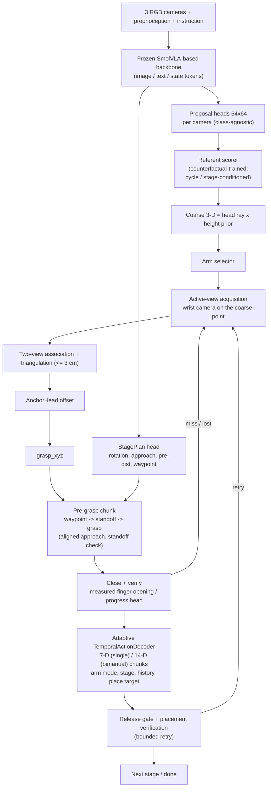
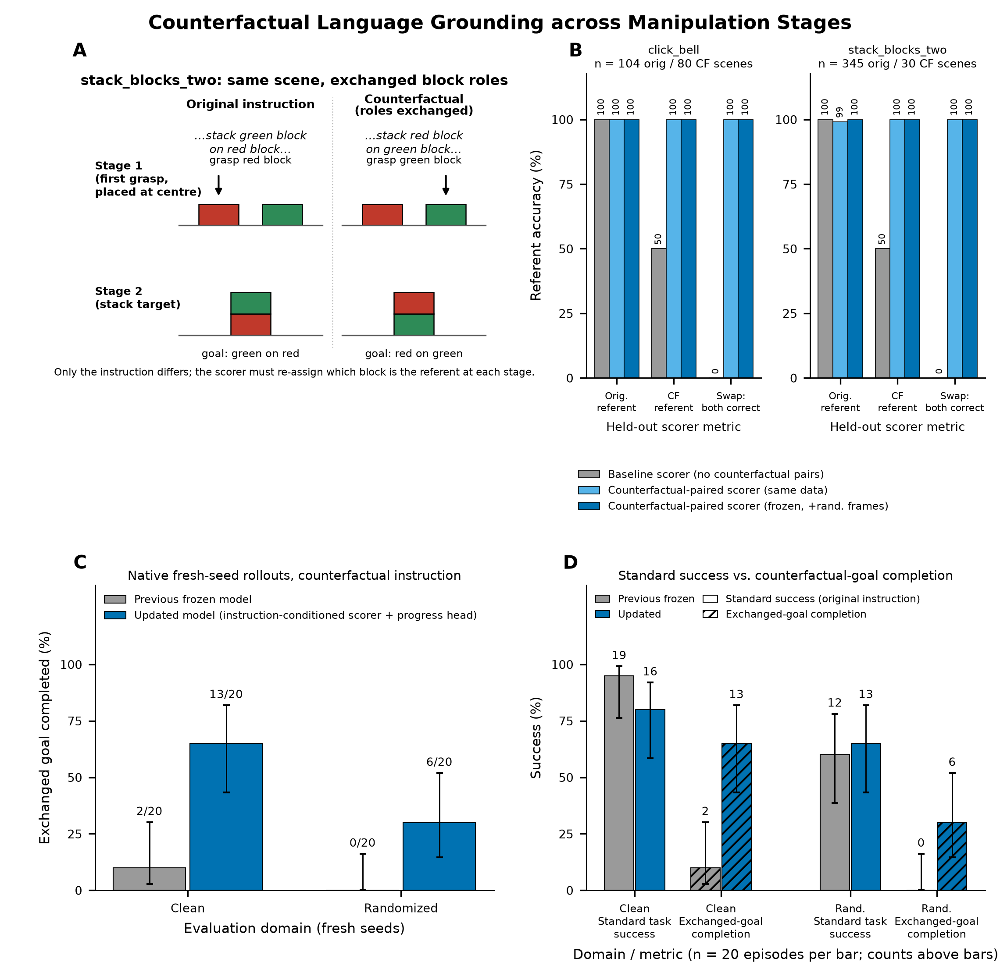
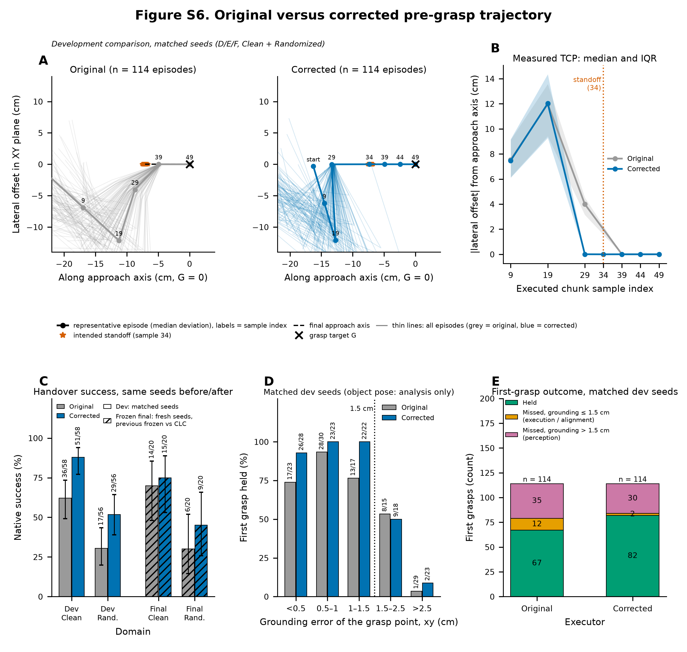

# ReGSP

ReGSP is a language-conditioned manipulation pipeline for single-arm and bimanual execution in the RoboTwin simulator (aloha-agilex embodiment). It selects the instructed object with a counterfactually trained referent scorer, localizes it by two-view triangulation, plans the grasp with a learned StagePlan head, and executes multi-stage episodes in a closed loop that verifies, re-grounds and retries.

It is developed from the grounded-final SafeDiff-VLA V21 (StagePlan-v2.1) methodology. This repository is the extraction of the final, frozen, verified RoboTwin implementation (V21-CLC, four tasks). It is a research code release, **not** a RoboTwin 50-task benchmark entry.

> **Status of the release.** Source code, configurations, frozen result tables, figures and checkpoint hashes are included. **Trained weights are not included and no public download location exists yet** (see [docs/CHECKPOINTS.md](docs/CHECKPOINTS.md)). Everything that needs weights is verified locally and documented, but cannot be reproduced by third parties until weights are released.

## Contents

[Overview](#overview) · [Relationship to SafeDiff-VLA](#relationship-to-safediff-vla) · [Architecture](#architecture) · [Key components](#key-components) · [Installation](#installation) · [Dataset](#dataset) · [Training](#training) · [Evaluation](#evaluation) · [Experimental results](#experimental-results) · [Reproducibility](#reproducibility) · [Limitations](#limitations) · [Citation](#citation) · [Acknowledgements and license](#acknowledgements-and-license)

## Overview

A manipulation policy that follows a language instruction has to solve four coupled problems:

1. **Visual grounding.** Find the instructed object in cluttered, domain-randomized scenes with metric accuracy (about 1 cm for a successful grasp).
2. **Language-conditioned referent selection.** The same scene can carry different instructions (for example, which of two blocks to grasp first). A scorer that ignores the instruction, or that only adds a stage index to it, picks the wrong object when the instruction is reversed. ReGSP trains the referent scorer on same-scene counterfactual instructions and, for multi-stage tasks, conditions it on the stage so that the *same* instruction is re-read at every stage.
3. **Sequential manipulation.** A stage advances on verified events (measured finger opening, observation-based progress verdict), never because an action chunk ended; failed grasps and placements are re-grounded and retried a bounded number of times.
4. **Coordinated dual-arm execution.** A single decoder predicts a synchronised 2 x 50-step chunk (7-D per arm, 14-D bimanual) conditioned on both arms' states, the stage and an arm-mode decision, so that hand-overs and receiving grasps are coordinated.

The released model runs four RoboTwin tasks with task-specific weights on a shared frozen vision-language backbone: `click_bell`, `place_container_plate` (single-arm path) and `stack_blocks_two`, `handover_block` (two-arm path).

## Relationship to SafeDiff-VLA

ReGSP is developed from the **grounded-final SafeDiff-VLA V21** methodology (research tags `safediff-stageplan-v2.1-grounded-final`, `safediff-stageplan-final-v1`). The original V21 was built for the VLABench embodiment. What was done here:

| | Components |
|---|---|
| **Inherited** (original V21 definitions, architecture unchanged, retrained per RoboTwin task) | frozen SmolVLA-based backbone tokens; class-agnostic 64x64 proposal head `Head(64)` with focal loss; HR referent scorer; two-ray Hungarian association (<= 3 cm gap) and triangulation; `AnchorHead`; `StagePlanV2Head` and the geometric pre-grasp chunk builder; `TemporalActionDecoder` with `TargetQueryExtractor`, `VisualGroundingCrossAttention`, `TargetPointHead` |
| **Embodiment adaptation** | RoboTwin Large_D435 camera model, per-frame live camera extrinsics, half-resolution decimation, calibrated tool-to-camera mount, numpy FK of the aloha-agilex arms, end-effector commands executed through RoboTwin's planner, anchor re-centering constant |
| **Extensions developed for RoboTwin** | active-view acquisition; learned arm selector; cycle loop; cycle-conditioned scorer and place-referent scorer; bimanual decoder; Randomized-domain proposal heads; counterfactual referent training; adaptive single/bimanual decoder with progress head; sequential memory gates, measured-finger verification and bounded retry; persistent instruction conditioning (stage-conditioned subgoal scorer, instruction-conditioned progress head); closed-loop grounding-to-action correction (aligned pre-grasp approach, placement verification, grounded fallback) |

The exact tagging of each class as original/embodiment/extension is in the module docstrings (`[O]`, `[R]`, `[E]`, `[X]`) and in [docs/ARCHITECTURE.md](docs/ARCHITECTURE.md).

**Scope of this release.** The RoboTwin implementation only. The VLABench pipeline (Grounded Stage Execution) of the same method family, the D2 50-task screening and the RGL/KSP ablation studies that exist in the research repository are not part of this release.

**What this is not.** Original SafeDiff-VLA checkpoints are not available on the development machine. The frozen backbone used here is a *reconstruction*: a fresh-initialised grounded-grasp-v2 decoder trained for 20k steps on `lerobot/vlabench_unified` on top of the public frozen `lerobot/smolvla_vlabench` backbone. All task heads are retrained on RoboTwin. The results below are therefore results of this RoboTwin adaptation, not an exact reproduction of any original checkpoint.

## Architecture



One *stage* is one grasp-to-release cycle of one arm. `stack_blocks_two` and `handover_block` run two stages (up to two arms at once); `click_bell` and `place_container_plate` run one. Per-stage flow, memory gates and the retry budget (`ACL_RETRY = 2`, decoder call budget 300) are described in [docs/ARCHITECTURE.md](docs/ARCHITECTURE.md).

## Key components

| Component | Code | Role |
|---|---|---|
| Frozen backbone | `regsp/backbone/` (vendored SafeDiff-VLA policy), `regsp/backbone/loader.py` | image/text/state latent tokens (960-d) and SigLIP patch features; never updated |
| Proposal heads | `regsp/grounding/proposals.py` | `Head(64)`: 64x64 (heat, du, dv) per camera on frozen SigLIP features; `decode` returns peaks (threshold 0.10, top 10) |
| Referent scorers | `regsp/grounding/scorer.py` | `Scorer` (HR "B"), `CycleScorer` (+cycle embedding), `SubgoalScorer` (+stage-specific text query) |
| Geometry | `regsp/grounding/geometry.py` | ray / projection, closest-approach triangulation, Hungarian two-ray association with 3 cm gate |
| AnchorHead | `regsp/grounding/anchor.py` | learned centre-offset of the triangulated referent (cm) |
| StagePlan | `regsp/planning/`, `regsp/backbone/stageplan_v2.py` | `StagePlanV2Head`, `StageVars`, `build_pregrasp_chunk` (50 samples: waypoint 19, standoff 34, grasp 49) |
| Decoders | `regsp/decoding/bimanual.py`, `adaptive.py` | `BimDecoder` (partner state, role, place target; zero-init), `AdaptiveDecoder` (joint P/Q chunks, arm-mode/stage/history terms) |
| Progress heads | `regsp/decoding/progress.py` | stage-completion logits (NOT_STARTED / IN_PROGRESS / COMPLETED / FAILED_OR_RECOVERY / TASK_COMPLETED) and arm-mode logits; `PicProgressHead` adds the instruction pathway |
| Closed-loop executor | `regsp/execution/closed_loop.py` (+ `base_policy.py`, `bimanual_policy.py`) | observe -> ground -> plan -> act -> verify -> retry; the frozen V21-CLC executor |
| Frozen configuration | `configs/final_v21_clc.json` | per-task executor options of the released model |
| RoboTwin adapter | `regsp/envs/robotwin.py`, `scripts/evaluate/robotwin_eval.py` | environment construction, seed/validity protocol, native success |

**Interfaces.** End-effector commands are 16-D (`[xyz(3), quat wxyz(4), gripper(1)] x [left, right]`); the decoder emits 10-D encoded chunks (xyz, sin/cos of 3 Euler angles, gripper) that decode to 7-D per arm, concatenated in fixed [L, R] order for the 14-D bimanual chunk. **Gripper polarity: 1.0 = open, 0.0 = closed**; a decoder gripper output > 0.5 is a release proposal; the measured finger opening is normalised so that 1 = open. These conventions are covered by `tests/`.

## Installation

Verified configuration (details and caveats in [docs/INSTALL.md](docs/INSTALL.md)): Linux, Python 3.12.16, PyTorch 2.7.1+cu128, transformers 5.22.2, numpy 1.26.4, upstream **lerobot 0.7.0**, RoboTwin commit `0aeea2d669c0f8516f4d5785f0aa33ba812c14b4` with SAPIEN 3.0.0b1 / mplib 0.2.1 / its bundled cuRobo, NVIDIA driver 615.71.09, RTX PRO 4500 Blackwell GPUs.

```bash
python -m venv .venv && . .venv/bin/activate           # Python 3.12
pip install torch==2.7.1 torchvision==0.22.1 --index-url https://download.pytorch.org/whl/cu128
pip install -r requirements.txt
pip install --no-deps lerobot==0.7.0                    # pins numpy>=2, which SAPIEN 3.0.0b1 cannot use; hence --no-deps
pip install -e . --no-deps
# simulator: clone RoboTwin at the pinned commit and follow its own installation instructions
git clone https://github.com/RoboTwin-Platform/RoboTwin && git -C RoboTwin checkout 0aeea2d669c0f8516f4d5785f0aa33ba812c14b4
export REGSP_ROBOTWIN_ROOT=$PWD/RoboTwin
```

ReGSP vendors the SafeDiff-VLA policy code and must **not** be combined with the SafeDiff research fork of LeRobot (both register the `safediff_vla` policy type; importing `regsp` then raises an explicit error).

Run the checkpoint-free tests: `pytest tests` (the weight-dependent tests skip themselves).

## Dataset

* **Demonstrations**: official RoboTwin LeRobot-v3.0 conversion `hxma/RoboTwin-LeRobot-v3.0` (revision `5d857cc7`, Apache-2.0 on the Hub): `aloha-agilex_clean_50` (Clean) and `aloha-agilex_randomized_500` (Randomized; only meta, parquet and the first video file, i.e. the first >= 100 episodes, per task, are used; `scripts/data/dl_rand.py`).
* **Cameras**: head (`cam_high` / `head_camera`), left wrist, right wrist; Large_D435, 640x480, pinhole `K = [[717.3,0,320],[0,717.3,240],[0,0,1]]`; images are decimated to 240x320 for features and letterboxed to 224x224 for the backbone. Wrist extrinsics are the live per-frame values delivered with each observation.
* **Simulator-generated training data** (labels use privileged simulator state, training only): scene snapshots, view sequences and active-observation views in Clean and in domain-randomized scenes (`scripts/data/gen_*`), counterfactual scenes (`gen_cf_bell.py`, `build_cf_cache.py`), on-policy progress samples with real perturbed outcomes (`scripts/train/acl_onpolicy.py`, `pic_*`).
* **Clean vs Randomized.** The released models are trained on the **union** of Clean and Randomized-domain data. The Randomized results are consequently **in-domain with respect to the randomization family, not zero-shot generalization**; the earlier Clean-only ten-task models collapse under randomization (6/100, see [History](#history-of-frozen-versions)).

## Training

Stages in dependency order (full commands, inputs and outputs: [docs/TRAINING.md](docs/TRAINING.md)). `REGSP_CLEAN_ROOT`, `REGSP_WORK_ROOT`, `REGSP_CLEAN_DATA`, `REGSP_BACKBONE_CKPT` select the data/work directories.

| Stage | Script | Output (bundle name) |
|---|---|---|
| 0 backbone (frozen thereafter) | `scripts/train/train_backbone.py` | `REGSP_BACKBONE_CKPT` |
| 1 labels, token caches, scenes/views | `scripts/data/build_labels_*.py`, `tokens_*.py`, `gen_*.py`, `build_*_cache.py` | caches |
| 2 proposal heads (Clean + Randomized views) | `scripts/train/train_da_heads.py TASK` | `proposal_*_camera.pt` |
| 3 referent scorer (counterfactual pairs) | `scripts/train/train_cf_scorer.py TASK cf\|base u1` | `referent_scorer.pt` |
| 4 AnchorHead | `scripts/train/train_da_anchor.py TASK` | `anchor_head.pt` |
| 5 StagePlan head | `scripts/train/train_sp_v2head.py TASK` | `stageplan_head.pt` |
| 6 task decoder | `scripts/train/train_sp_decoder.py TASK pretrained 10000` | `decoder.pt` |
| 7 bimanual decoder | `scripts/train/train_sp_bimdec.py TASK b1 8000` | `bim_decoder.pt` |
| 8 adaptive decoder + progress head | `scripts/train/train_acl.py TASK a1 8000`, on-policy labels, `... a2 3000` | `progress.pt` (handover) |
| 9 persistent instruction conditioning (`stack_blocks_two`) | `scripts/train/train_pic_scorer.py`, `train_pic.py` | `subgoal_scorer.pt`, `progress.pt` |
| 10 closed-loop correction | no training: executor options + `scripts/data/clc_build_stats.py` | `regsp/data/clc_stats.json` |

> The training scripts were ported mechanically (paths and imports) from the research tree and were **compiled and import-checked but not re-run**: no training was launched during the extraction. Their provenance and the commands that produced the released weights are in [docs/PROVENANCE.md](docs/PROVENANCE.md) and [docs/history/](docs/history/).

## Evaluation

```bash
export REGSP_BACKBONE_CKPT=/path/to/pretrained_model   # frozen backbone
export REGSP_CKPT_ROOT=/path/to/bundle                 # per-task weights (docs/CHECKPOINTS.md)
export REGSP_ROBOTWIN_ROOT=/path/to/RoboTwin

# frozen final protocol: n = 20 valid episodes per cell, fresh seeds Clean 8200000+, Randomized 8700000+
scripts/evaluate/run_eval.sh 0 runs/final click_bell:clean click_bell:rand place_container_plate:clean place_container_plate:rand
scripts/evaluate/run_eval.sh 1 runs/final stack_blocks_two:clean stack_blocks_two:rand handover_block:clean handover_block:rand
python scripts/evaluate/aggregate_results.py runs/final --csv runs/final/summary.csv

# one episode (smoke test)
scripts/demo/rollout_one_episode.sh 0 runs/demo click_bell clean
# load every task's weights and compare with the frozen reference digests (no episode is run)
python scripts/utils/verify_bundle_load.py
```

Protocol (`configs/final_v21_clc.json`): seed slots start at the stated seed; a seed is *valid* only if RoboTwin's scripted expert solves the scene (used solely as a validity screen; the policy never sees expert or simulator object state); invalid seeds are skipped; success is the simulator's own `eval_success`; per-seed timeout 1500 s; at most 3 infrastructure attempts per seed. Randomized = RoboTwin `demo_randomized`. Instructions: `seen` type.

<!--
## Experimental results

**Released version: V21-CLC** (closed-loop grounding-to-action correction on top of the persistent-instruction model), frozen before any final episode (`results/final_v21_clc/freeze_protocol.json`). Source: per-episode records of the frozen final run, re-aggregated here (`results/final_v21_clc/episodes_regsp.csv`, `summary_regsp.csv`); they reproduce `CLC_FINAL_RESULTS.csv` exactly.

**Native success, fresh seeds (Clean 8200000+, Randomized 8700000+), n = 20 valid episodes per cell, Wilson 95 % intervals.**

| Task | Path | Executor configuration | Clean | 95 % CI | Randomized | 95 % CI |
|---|---|---|---|---|---|---|
| `click_bell` | single-arm | unchanged freeze3 (regression control) | 20/20 | 83.9-100 | 19/20 | 76.4-99.1 |
| `place_container_plate` | single-arm | aligned approach, grounded fallback, placement verification + bounded retry, grounding cross-checks | 18/20 | 69.9-97.2 | 14/20 | 48.1-85.5 |
| `stack_blocks_two` | two-arm | unchanged freeze3 (stage-conditioned subgoal scorer, instruction-conditioned progress head) | 18/20 | 69.9-97.2 | 13/20 | 43.3-81.9 |
| `handover_block` | two-arm | aligned approach with standoff verification | 15/20 | 53.1-88.8 | 9/20 | 25.8-65.8 |
| **Pooled (4 tasks)** | | | **71/80 = 88.75 %** | | **55/80 = 68.75 %** | |

**Matched-seed comparison with the previous frozen configuration (freeze3, same seeds, same protocol):**

| Task | Clean CLC / previous | Randomized CLC / previous | Note |
|---|---|---|---|
| `click_bell` | 20 / 20 | 19 / 19 | same configuration both runs |
| `place_container_plate` | 18 / 17 | 14 / 8 | changed; Randomized: 6 episodes only CLC, 0 only previous |
| `stack_blocks_two` | 18 / 17 | 13 / 15 | same configuration both runs: **differences are run-to-run variation** |
| `handover_block` | 15 / 14 | 9 / 6 | changed; Randomized: the two runs share 19 of 20 seeds (one scene skipped differently in each); on the 19 common seeds 8 vs 6 |
| Pooled | 71 / 68 | 55 / 48 | two changed tasks only: Clean 33/40 vs 31/40, Randomized 23/40 vs 14/40 |

How to read these numbers:

* n = 20 per cell: a difference of 1-3 episodes in a single cell is noise. Identical configurations on identical seeds differ by this much (`stack_blocks_two` Randomized 13 vs 15, `click_bell` 19 vs 19 with one episode swapped each way). The simulator is not bit-reproducible; reruns reproduce rates within sampling noise, not per-seed outcomes.
* The clearest effect is `place_container_plate` Randomized (14 vs 8, no regression). The `handover_block` gain is within final-run noise by itself; the selection of its configuration rests on the pooled development evidence (n = 60 per cell, three seed blocks: Randomized 32/60 vs 19/60, Clean 53/60 vs 37/60), which is **development data and is not a benchmark result**.
* The 80 % Randomized average that was set as a goal was **not reached** (68.75 %); `handover_block` Randomized (45 %) is the weakest cell.
* This is a **four-task study**. No RoboTwin 50-task benchmark number is claimed.
* Per-task configurations (and the options that were evaluated but rejected on development seeds) are in `configs/final_v21_clc.json` and [docs/history/V21_CLC_FINAL_REPORT.md](docs/history/V21_CLC_FINAL_REPORT.md).

### History of frozen versions

Each row is a different frozen version evaluated in its own fresh-seed protocol. **Seed sets differ between rows, so the rows are not matched comparisons.** Only the "previous model on the same seeds" values reported by each stage in its own report are matched. Details: [docs/HISTORY.md](docs/HISTORY.md).

| Version | Training domain | Eval seeds (Clean / Rand), n per cell | click_bell | place_container_plate | stack_blocks_two | handover_block | Pooled Clean / Rand |
|---|---|---|---|---|---|---|---|
| Original ten-task V21-family reconstruction (10 tasks; four shown) | Clean demos only | 9000000+ / 9500000+, 10 | 9/10 / 1/10 | 7/10 / 0/10 | 6/10 / 0/10 | 0/10 / 0/10 | 36/100 / 6/100 over all 10 tasks |
| Same ten-task models re-evaluated on four-task seeds ("baseline") | Clean demos only | 6000000+ / 6500000+, 20 | 17/20 / 6/20 | 14/20 / 5/20 | 11/20 / 0/20 | 0/20 / 0/20 | 42/80 / 11/80 |
| Four-task fully retrained V21 ("full") | Clean + Randomized | 6000000+ / 6500000+, 20 | 20/20 / 18/20 | 14/20 / 11/20 | 13/20 / 4/20 | 4/20 / 0/20 | 51/80 / 33/80 |
| + adaptive single/bimanual decoder, multi-stage closed loop (ACL) | Clean + Randomized | 8000000+ / 8500000+, 20 | 20/20 / 17/20 | 16/20 / 8/20 | 18/20 / 15/20 | 13/20 / 6/20 | 67/80 / 46/80 |
| + persistent instruction conditioning (PIC; only `stack_blocks_two` changed) | Clean + Randomized | 8100000+ / 8600000+, 20 | 20/20 / 14/20 | 16/20 / 10/20 | 16/20 / 13/20 | 14/20 / 5/20 | 66/80 / 42/80 |
| **+ grounding-to-action correction (CLC), released** | Clean + Randomized | 8200000+ / 8700000+, 20 | 20/20 / 19/20 | 18/20 / 14/20 | 18/20 / 13/20 | 15/20 / 9/20 | **71/80 / 55/80** |

The "same-seed previous model" results inside each stage (PIC: ACL model on the PIC seeds; CLC: PIC model on the CLC seeds) are in the stage reports under `docs/history/` and in `results/history/`. In the PIC stage, only `stack_blocks_two` was changed and its standard task success did not improve; its effect is on counterfactual-instruction goal completion (figure below). Early-stage seed ranges were also used for development in some versions; see the reports for what was selected on which seeds.

### Figures

**Counterfactual language grounding across manipulation stages** (`stack_blocks_two`; click_bell offline reference). Panel A: schematic. Panel B: offline scorer-level accuracy. Panels C/D: native fresh-seed rollouts of the PIC stage (Clean 8100000+, Randomized 8600000+, n = 20) with the role-exchanged instruction; counterfactual-goal completion uses privileged final block poses and is analysis only. Caption and provenance: [figures/Counterfactual_Language_Grounding_caption.txt](figures/Counterfactual_Language_Grounding_caption.txt), [sources](figures/Counterfactual_Language_Grounding_sources.txt).



**Original versus corrected pre-grasp trajectory** (`handover_block`). Panels A, B, D, E and the "Dev" groups of C are **development** comparisons on matched development seeds; only the hatched "Final" groups of panel C are the frozen final run. Privileged object poses are used for the analysis panels only. Caption and provenance: [figures/Figure_S6_caption.txt](figures/Figure_S6_caption.txt), [sources](figures/Figure_S6_sources.txt).



The plotting scripts are in `figures/src/` (they read the research-tree outputs; set `REGSP_RESEARCH_TREE`). Regenerating them from the research tree reproduced the PNG byte for byte (SVG differs only in embedded date/ids).

## Reproducibility

* **Configuration identifier**: `V21-CLC`, frozen 2026-11-17T05:22:57Z (`configs/final_v21_clc.json`, `results/final_v21_clc/freeze_protocol.json`); 73 files hashed in `results/final_v21_clc/MANIFEST_FREEZE4.sha256` (32 of the 33 bundle files were re-checked against these hashes; the 33rd, the `handover_block` place-referent scorer, predates this manifest. Every checkpoint is bit-identical to the previous frozen configuration (freeze3); only the executor changed).
* **Checkpoints**: canonical names, SHA-256 and research-tree provenance in `configs/bundle_manifest.json`; backbone `model.safetensors` SHA-256 `b8cc22a6...b509`. Verify with `python scripts/utils/assemble_bundle.py --verify $REGSP_CKPT_ROOT`.
* **Equivalence with the frozen research stack**: `configs/reference_module_digests.json` holds per-module weight digests (backbone, heads, scorers, anchor, decoders, progress head, statistics, executor flags) of the frozen policy; `pytest tests/test_checkpoint_compat.py` checks that `regsp` on upstream `lerobot==0.7.0` loads digests identical to the research fork for all four tasks.
* **Seeds**: simulator scene seeds are fixed by the protocol; model/optimiser seed 1000 for all trainers; the executor is deterministic given observations. SAPIEN rendering/physics is not bit-reproducible on the verification machine: re-running the same seed can differ by about +-2 successes at n = 12, so expect rates within sampling noise rather than identical per-seed outcomes.
* **Verification actually performed** is listed in [docs/VERIFICATION.md](docs/VERIFICATION.md), including what was *not* done (no training re-run, no 160-episode re-evaluation).

## Limitations

* **Grounding**: the lateral component of the triangulated grasp point comes from the wrist proposal peak (about 1 cm in Randomized scenes); when the grounding error exceeds about 1.5 cm the grasp still fails (`handover_block`) and a toppled box is not recovered by the retries. In `place_container_plate` Randomized, head-view referent selection still fails in a substantial fraction of scenes and the grounded fallback succeeds in only about half of its uses.
* **Verification**: the placement verifier cannot decide in a large share of episodes (no confident referent after release); the executor then proceeds without retry.
* **Scope**: four tasks, task-specific weights, Randomized-domain adaptation. Two tasks (`click_bell`, `stack_blocks_two`) run the regression-control configuration; no task is claimed to generalize to unseen tasks or domains. `handover_block` and `place_container_plate` have no semantically valid counterfactual instruction, so counterfactual referent training applies to `click_bell` and `stack_blocks_two` only.
* **Statistics**: n = 20 per cell; Wilson intervals overlap for most pairwise comparisons.
* **Backbone** is a reconstruction (see above); the checkpoint is not public.
* **Runtime nondeterminism** (simulator; infrastructure restarts) and the expert-validity screen (seed slots that the scripted expert fails are skipped, so the set of evaluated scenes depends on RoboTwin's expert).
* **Privileged simulator state** is used only for training-time labels, offline diagnostics and some figures, never as a policy input at inference.
* **Fork independence**: the vendored backbone code and `lerobot==0.7.0` were verified weight-identical to the research fork for loading; backbone *training* through `lerobot-train` was not verified outside the fork.
-->


## Citation

No paper or archival identifier exists yet. Placeholder for the repository owner:

```bibtex
@misc{regsp,
  title  = {ReGSP},
  author = {TODO: authors},
  year   = {TODO},
  note   = {TODO: add paper / DOI / URL when available}
}
```

## Acknowledgements and license

ReGSP builds on **SafeDiff-VLA** (the V21 StagePlan methodology and its LeRobot-based implementation), **LeRobot** (Hugging Face, Apache-2.0; this repository vendors derived policy code, see [NOTICE](NOTICE)), **SmolVLA / SmolVLM2** (Apache-2.0), **RoboTwin** (Tianxing Chen et al., MIT License) and its LeRobot-format dataset `hxma/RoboTwin-LeRobot-v3.0`, and **VLABench** data (`lerobot/vlabench_unified`) used to train the frozen backbone. Upstream code is not claimed as ReGSP work.

Code: Apache License 2.0 ([LICENSE](LICENSE)), chosen because the vendored policy code derives from Apache-2.0 LeRobot sources; the repository owner should confirm this choice before publication. Model weights are not covered by this repository's license and are not distributed.
